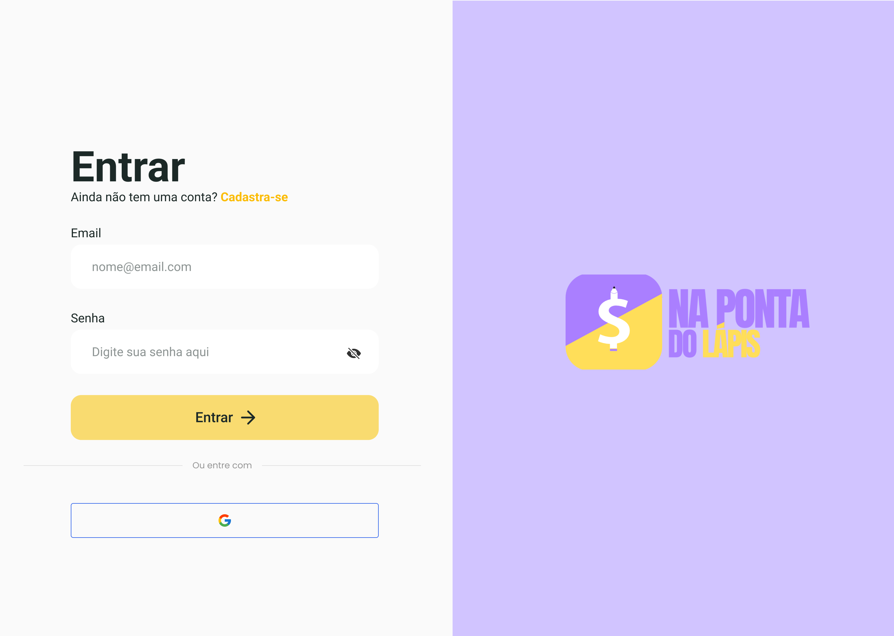
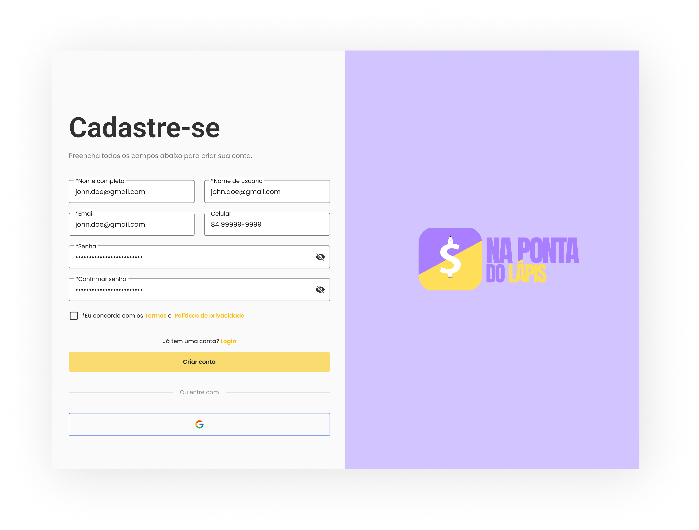
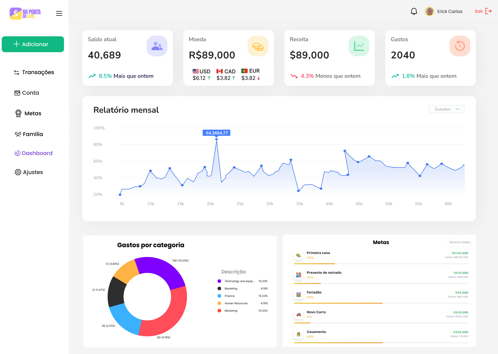
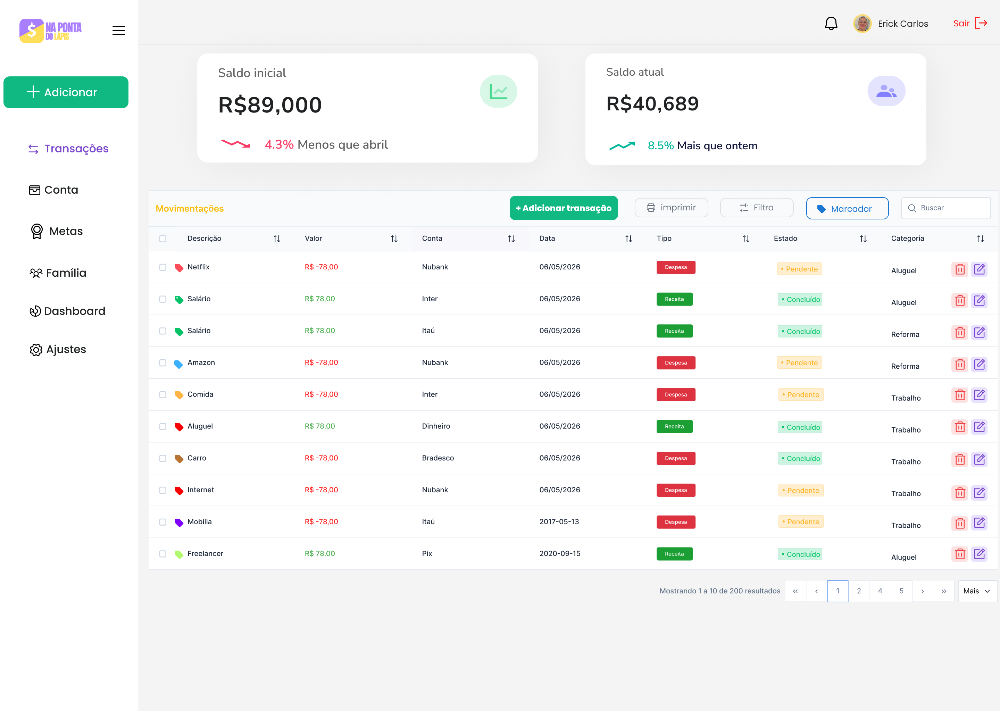
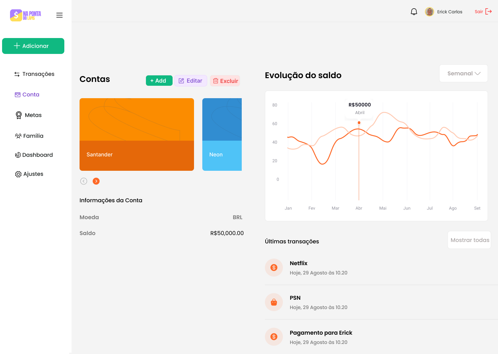
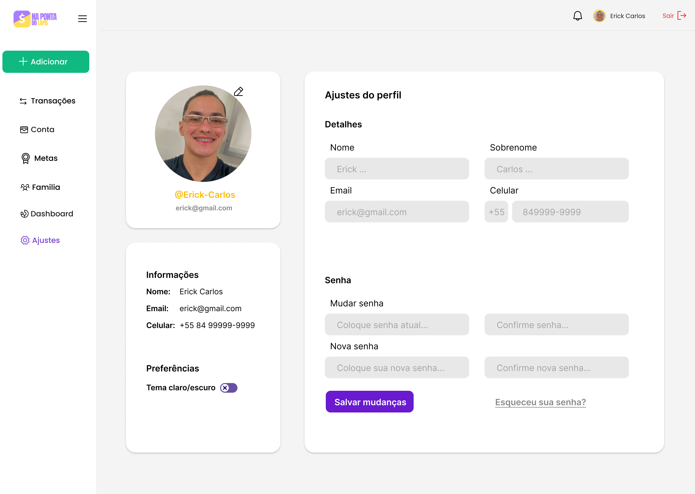

# Na Ponta do Lápis


Sistema web voltado para jovens que estão iniciando a vida adulta. A plataforma oferece ferramentas de controle financeiro, planejamento de gastos e educação financeira personalizada — ajudando o usuário a desenvolver hábitos saudáveis de gestão do dinheiro e construir uma base sólida para o crescimento pessoal e profissional.


## Landing Page


## Login


## Cadastro


## Dashboard


## Transação


## Conta


## Configuração


## Stack

- **Backend:** Java 21 + Spring Boot 3.5 + PostgreSQL (ou H2 em memória)
- **Frontend:** Angular 21 + PrimeNG + Tailwind CSS
- **Autenticação:** JWT (jjwt 0.12)
- **Docs da API:** Swagger UI em `/api/docs`

---

## Modos de Execução

Você pode executar o projeto de três formas diferentes:
1. **[Docker Compose (Recomendado)](#1-docker-compose-stack-completa)** — sobe banco de dados, backend e frontend com proxy Nginx em containers isolados.
2. **[DevContainer / GitHub Codespaces](#2-devcontainer--github-codespaces)** — ambiente de desenvolvimento pronto no VS Code ou navegador sem instalar dependências no host.
3. **[Execução Local Manual (Bare Metal)](#3-execução-local-manual-bare-metal)** — roda cada serviço diretamente na sua máquina para ciclo ágil de desenvolvimento.

---

### Configuração Inicial: Variáveis de Ambiente

Antes de iniciar, crie o arquivo `.env` na raiz do projeto a partir do exemplo fornecido:

```bash
cp .env.example .env
```

Edite o arquivo `.env` caso precise customizar credenciais de banco de dados (`POSTGRES_DB`, `POSTGRES_USER`, `POSTGRES_PASSWORD`) ou segredos de autenticação (`JWT_SECRET`). Para o upload de fotos, preencha `CLOUDINARY_*`. A chave de IA para leitura de faturas não fica no `.env`: cada usuário a informa na tela de importação.

> **Arquivo único centralizado:** O backend foi configurado para detectar automaticamente o arquivo `.env` na raiz do projeto (ou no subdiretório se existir). Basta criar um único `.env` na raiz!

---

### 1. Docker Compose (Stack Completa)

Ideal para rodar toda a aplicação localmente de maneira idêntica à produção.

**Pré-requisitos:** [Docker](https://docs.docker.com/get-docker/) e [Docker Compose](https://docs.docker.com/compose/) instalados.

1. Garanta que o arquivo `.env` foi criado na raiz:
   ```bash
   cp .env.example .env
   ```

2. Suba todos os containers (PostgreSQL, Backend e Frontend):
   ```bash
   docker compose -f docker-compose.local.yml up --build
   ```
   > Adicione `-d` no final se quiser liberar o terminal e rodar em segundo plano.

3. Para encerrar os serviços:
   ```bash
   docker compose -f docker-compose.local.yml down
   ```

Acessos nesta modalidade:
- **Frontend (Web):** [http://localhost:8081](http://localhost:8081) *(o Nginx redireciona `/api` internamente para o backend)*
- **Backend direto:** [http://localhost:8080/api](http://localhost:8080/api)
- **Documentação Swagger UI:** [http://localhost:8080/api/docs](http://localhost:8080/api/docs)

---

### 2. DevContainer / GitHub Codespaces

Perfeito para desenvolver sem poluir sua máquina local.

> Funciona no **VS Code** com a extensão *Dev Containers* instalada ou direto no **GitHub Codespaces**.

O ambiente sobe automaticamente:
- Container Java 21 + Maven
- Container PostgreSQL 16 (banco `npl_db`, usuário `postgres`)
- Node.js 22+ com Angular CLI 21

**Passos:**
1. Abra o repositório no VS Code e clique em **"Reopen in Container"** (ou crie um Codespace no GitHub).
2. Aguarde o término do build inicial do container.
3. No terminal integrado (já aberto na raiz do projeto), **instale as dependências de ambos os projetos**:
   ```bash
   npm run install:all
   ```
   *(Este comando executa o `npm install` no frontend e o `./mvnw clean install` no backend de uma só vez)*.
4. Inicie o frontend e o backend simultaneamente:
   ```bash
   npm run dev      # inicia frontend e backend simultaneamente da raiz
   ```
   > **No VS Code:** Você também pode pressionar `Ctrl+Shift+B` (ou abrir o menu *Terminal > Run Task...* e escolher **Start All (Dev)**) para rodar frontend e backend em terminais dedicados com logs separados.

> **Nota (Codespaces):** Se a porta `4200` não abrir automaticamente, certifique-se de marcá-la como **Public** na aba *Ports*.

---

### 3. Execução Local Manual (Bare Metal)

Ideal para desenvolvedores que preferem rodar e debugar cada serviço nativamente no host.

#### Passo 1: Instalação das Dependências (Front + Back)
Antes de executar qualquer serviço pela primeira vez, instale todas as dependências direto da raiz do repositório:
```bash
npm run install:all
```
> Esse atalho instala as dependências do Angular (`npm install`) e faz o build inicial das dependências Maven do Spring Boot (`mvnw clean install -DskipTests`).

---

#### Passo 2: Execução Rápida (Direto da Raiz)
Se você já tem Java 21 e Node instalados, não precisa navegar entre pastas para rodar o projeto:
```bash
npm run dev           # Sobe frontend (Angular) e backend (Spring Boot) em paralelo
npm run dev:front     # Sobe apenas o frontend
npm run dev:back      # Sobe apenas o backend com PostgreSQL
npm run dev:back:h2   # Sobe apenas o backend com banco em memória H2 (sem precisar instalar PostgreSQL)
```

> **Dica para usuários Windows:**
> - O script composto `npm run dev` utiliza comandos Unix (`trap` e `&`). No Windows nativo, execute através do **Git Bash**, **WSL** ou pressione `Ctrl+Shift+B` no VS Code para iniciar a task **Start All (Dev)**.
> - Se preferir rodar via PowerShell/CMD, abra dois terminais e execute `npm run dev:front` em um e `npm run dev:back` (ou `npm run dev:back:h2`) no outro.

---

#### Ou execute cada serviço individualmente nos subdiretórios:

##### Passo 1: Banco de Dados
- **Opção A (PostgreSQL Local):** Certifique-se de que o Postgres está ativo na porta `5432` com o banco `npl_db`.
- **Opção B (H2 em memória - sem banco instalado):** Use o profile `h2` para rodar sem banco externo.

##### Passo 2: Backend (Spring Boot)
```bash
cd backend/na-ponta-do-lapis

# No Linux/macOS ou Git Bash (ele lerá automaticamente o .env da raiz):
chmod +x mvnw
./mvnw spring-boot:run # ou: ./mvnw spring-boot:run -Dspring-boot.run.profiles=h2

# No Windows (CMD / PowerShell):
.\mvnw.cmd spring-boot:run # ou: .\mvnw.cmd spring-boot:run -Dspring-boot.run.profiles=h2
```
Backend ativo em: [http://localhost:8080/api](http://localhost:8080/api).

##### Passo 3: Frontend (Angular)
```bash
cd frontend/na-ponta-do-lapis
npm install
npm start
```
Frontend ativo em: [http://localhost:4200](http://localhost:4200).

---

### Scripts Disponíveis na Raiz (`package.json`)

Para facilitar o fluxo de desenvolvimento, utilize os comandos orquestrados a partir da raiz:

| Script | O que faz |
|---|---|
| `npm run install:all` | Instala todas as dependências do frontend (`npm install`) e backend (`mvnw clean install`) |
| `npm run dev` | Executa frontend (Angular) e backend (Spring Boot) em paralelo |
| `npm run dev:front` | Inicia apenas o frontend Angular na porta 4200 |
| `npm run dev:back` | Inicia apenas o backend com perfil PostgreSQL padrão |
| `npm run dev:back:h2` | Inicia o backend com banco em memória H2 (não precisa de Postgres) |
| `npm run build` | Compila o build de produção do frontend e gera o arquivo JAR do backend |
| `npm test` | Executa toda a suíte de testes (Frontend + Backend) |
| `npm run test:front` | Executa apenas os testes unitários do frontend (Vitest) |
| `npm run test:back` | Executa apenas os testes unitários do backend (Spring Boot / JUnit) |
| `npm run compose:up` | Constrói e sobe toda a stack via Docker Compose |
| `npm run compose:down` | Para e desfaz a infraestrutura do Docker Compose |

---

### Executando Testes Automatizados

Você pode rodar os testes diretamente da raiz ou em cada módulo:

- **Pela Raiz do Projeto:**
  ```bash
  npm test             # Executa a suíte de testes de ambos (front + back)
  npm run test:front   # Apenas testes do Angular
  npm run test:back    # Apenas testes do Spring Boot
  ```

- **Nos Subdiretórios:**
  ```bash
  # Backend
  cd backend/na-ponta-do-lapis && ./mvnw test

  # Frontend
  cd frontend/na-ponta-do-lapis && npm test
  ```

---

## URLs e Endpoints Úteis

| Recurso / Serviço | URL no Dev Local | URL no Docker Compose |
|---|---|---|
| **Frontend Web** | [http://localhost:4200](http://localhost:4200) | [http://localhost:8081](http://localhost:8081) |
| **API Base** | [http://localhost:8080/api](http://localhost:8080/api) | [http://localhost:8080/api](http://localhost:8080/api) ou `/api` via Nginx |
| **Documentação Interativa (Swagger UI)** | [http://localhost:8080/api/docs](http://localhost:8080/api/docs) | [http://localhost:8080/api/docs](http://localhost:8080/api/docs) |
| **Especificação OpenAPI (JSON)** | [http://localhost:8080/api/api-docs](http://localhost:8080/api/api-docs) | [http://localhost:8080/api/api-docs](http://localhost:8080/api/api-docs) |
| **Health Check (Actuator)** | [http://localhost:8080/api/actuator/health](http://localhost:8080/api/actuator/health) | [http://localhost:8080/api/actuator/health](http://localhost:8080/api/actuator/health) |
| **Console H2** *(somente se profile `h2` ativo)* | [http://localhost:8080/api/h2-console](http://localhost:8080/api/h2-console) | — |

---

## Equipe

| Nome |  |
|---|---|
| Bruno Dias | [Linkedin](https://www.linkedin.com/in/bruno-diasz/) |
| Eduardo Aguiar | [Linkedin](https://www.linkedin.com/in/eduardo-medeiros-62b97a335/)|
| Erick Carlos | [Linkedin](https://www.linkedin.com/in/erick003/)|
| Lucas Medeiros | |
| Pedro Gomes | [Linkedin](https://www.linkedin.com/in/pedro-ricardo-gomes/) |
| Vinicius Vasconcelos | |
| Wagner Souza | [Linkedin](https://www.linkedin.com/in/wagner-alves-de-souza-922433272/?skipRedirect=true)|


## Contribuindo e Reportando Problemas

Encontrou algum bug, inconsistência ou tem uma sugestão de nova funcionalidade?

- Acesse a aba de **[Issues](https://github.com/tads-cnat/na-ponta-do-lapis/issues)** do repositório.
- Clique em **New Issue** e selecione o formulário correspondente (**Reportar um Bug** ou **Sugerir Funcionalidade**).
- Preencha os campos solicitados para que o time possa reproduzir ou priorizar a tarefa.

---

## Módulos de Documentação

A documentação do projeto está dividida por áreas de interesse:

| Módulo | Descrição | Link |
|---|---|---|
| **Engenharia de Software** | Documento de visão, protótipos, modelo de domínio, casos de uso e riscos | [doc/documentacao.md](doc/documentacao.md) |
| **Arquitetura & Deploy** | Topologia em nuvem (Oracle/Coolify), proxy Nginx, CI/CD e rollback | [deploy/README.md](deploy/README.md) |
| **Backend (Spring Boot)** | Guia do servidor Java 21, profiles (Postgres/H2), testes e endpoints | [backend/README.MD](backend/README.MD) |
| **Frontend (Angular)** | Guia da aplicação SPA, scripts, temas PrimeNG e testes com Vitest | [frontend/README.MD](frontend/README.MD) |
