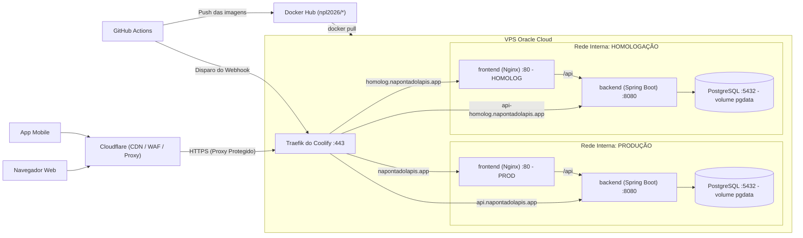
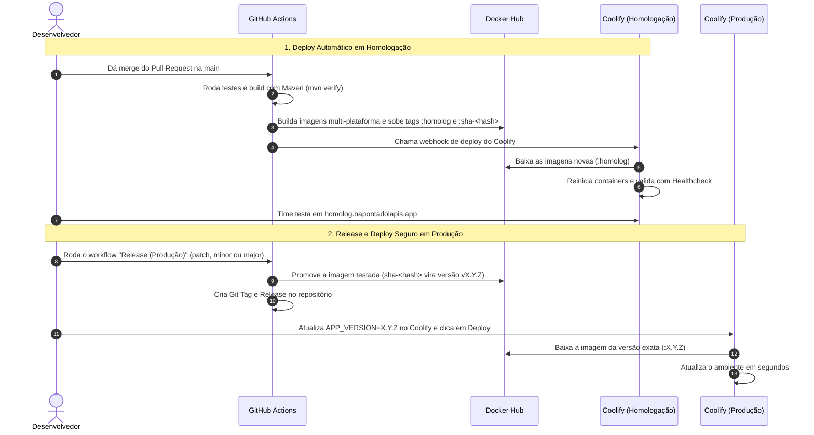

# Como funciona o Deploy e o CI/CD do Na Ponta do Lápis 

Documentação prática de como a nossa infraestrutura e a esteira de CI/CD foram organizadas para colocar o projeto no ar, dividindo os ambientes em **Homologação** (pra testar tudo antes) e **Produção** (ambiente real do usuário).

---

## 1. Como a nossa infraestrutura tá montada

A aplicação roda em uma **VPS na Oracle Cloud** utilizando o **Coolify** como orquestrador, com o **Cloudflare** na borda (CDN, WAF, proxy reverso e proteção de IP) e o **Traefik** gerenciando o roteamento interno com certificados SSL/HTTPS automáticos. Cada serviço roda isolado via **Docker Compose**.

### Cuidados de segurança que tomamos:
- **Proteção de Borda com Cloudflare:** O IP público real da VPS Oracle fica 100% oculto atrás da rede Anycast da Cloudflare, com proteção contra DDoS, WAF e aceleração de cache CDN para o frontend.
- **Rastreabilidade e IP Real:** O Traefik do Coolify está configurado com `trustedIPs` oficiais da Cloudflare, garantindo que o cabeçalho `CF-Connecting-IP` repasse o IP verdadeiro de cada visitante para os logs e para o Spring Boot.
- **Portas fechadas no host:** A gente não usa `ports:` aberta no servidor. Apenas o Traefik escuta as portas públicas `80` e `443`.
- **Banco de dados blindado:** O container do PostgreSQL só usa `expose: ["5432"]` na rede interna dos containers. Ele **nunca** tem domínio público nem fica exposto pra internet. Só o nosso próprio backend consegue falar com ele.
- **Homologação e Produção separados:** Cada ambiente tem sua própria rede interna e seu próprio volume de dados (`pgdata`). O que a gente testa ou quebra em homologação não afeta em nada a produção.

---

## 2. A sacada do acesso híbrido: Web vs Mobile

Ao planejar a API, resolvemos um problema clássico de arquitetura: **como servir o frontend web e o aplicativo mobile ao mesmo tempo sem dor de cabeça com CORS e sem precisar compilar o Angular duas vezes?**

Adotamos uma abordagem híbrida:

| Quem tá chamando? | Por onde entra? | Como funciona na prática? | Vantagem |
|---|---|---|---|
| **Frontend Web** | `napontadolapis.app/api` | O Angular faz chamadas relativas (`/api/...`). O Nginx do próprio container recebe e repassa internamente pro Spring Boot. | **Zero erro de CORS** e sem requisição extra de preflight (`OPTIONS`). Além disso, a **mesma imagem Docker** de homologação serve pra produção sem precisar de rebuild. |
| **App Mobile / Terceiros** | `api.napontadolapis.app/api/v1` | O app mobile chama direto o subdomínio da API pelo Traefik. | Apps nativos (Kotlin/Flutter/React Native) não sofrem com regras de CORS de navegador e já consomem uma URL pública direta. |

> Ambas as rotas chegam no **mesmo container backend**, sem duplicar código nem subir instâncias extras à toa.

---

## 3. O fluxo de CI/CD no dia a dia

Toda a automação foi desenhada no **GitHub Actions** pra evitar trabalho manual e garantir que nada quebrado chegue em produção:

---

## 4. Guia rápido pra equipe

### Subindo uma feature nova (Homologação)
1. Trabalhe na sua branch normalmente e abra um Pull Request para a `main`.
2. O CI valida o código e executa os testes automatizados do backend e frontend.
3. Fez o merge na `main`? **O deploy em homologação é 100% automático!**
   - O GitHub Actions builda as imagens, sobe pro Docker Hub e avisa o Coolify.
   - Poucos minutos depois, a versão já tá disponível pra testar em:  
     **Web:** `https://homolog.napontadolapis.app`  
     **API:** `https://api-homolog.napontadolapis.app/api/v1`

---

### Lançando uma versão nova (Produção)
Quando a versão em homologação estiver testada e aprovada:
1. Vá na aba **Actions** do GitHub.
2. Selecione o workflow **Release (Produção)** e clique em **Run workflow**.
3. Escolha o tipo de versão:
   - `patch`: Correções de bugs (ex: `1.0.0` → `1.0.1`).
   - `minor`: Novas funcionalidades sem quebrar o que já existe (ex: `1.0.0` → `1.1.0`).
   - `major`: Mudanças estruturais grandes (ex: `1.0.0` → `2.0.0`).
4. O workflow vai calcular a versão automaticamente e promover a imagem do Docker Hub **sem recompilar nada do zero** (garantindo que o que vai pra produção é exatamente o que testamos em homologação).
5. No painel do **Coolify**:
   - Vá no recurso de **Produção** → aba **Environment Variables**.
   - Atualize `APP_VERSION` com a versão gerada (ex: `1.0.1`).
   - Clique no botão **Deploy**. Pronto!

---

### Deu ruim em produção? Como fazer Rollback:
Como todas as versões no Docker Hub são salvas com tags fixas (`1.0.0`, `1.0.1`...):
1. Abra o recurso de Produção no Coolify.
2. Mude `APP_VERSION` de volta para a versão estável anterior (ex: `1.0.0`).
3. Clique em **Deploy**.
4. Em menos de 1 minuto o container antigo volta a rodar, sem precisar de commit de emergência na correria.

---

## 5. Como o Compose de Produção tá estruturado

O arquivo [docker-compose.deploy.yml](file:///home/diasz/Projects/na-ponta-do-lapis/deploy/docker-compose.deploy.yml) é o modelo que colamos no Coolify:

- **`db` (Postgres 16):** Configurado com volume nomeado `pgdata` pra nunca perder dados quando o container reiniciar.
- **`backend` (Spring Boot):** Puxa a imagem `npl2026/backend:${APP_VERSION}` e tem um healthcheck configurado no endpoint do Spring Actuator (`/api/actuator/health`). O Coolify só direciona o tráfego quando o healthcheck retornar status `UP`.
- **`frontend` (Angular + Nginx):** Puxa `npl2026/frontend:${APP_VERSION}` e cuida de entregar os arquivos estáticos compilados do Angular e redirecionar as chamadas de `/api` pro backend.

### Variáveis de ambiente no Coolify (homologação x produção)

O **mesmo** `docker-compose.deploy.yml` é usado nos dois ambientes. O Coolify só entrega ao container as variáveis que aparecem no bloco `environment:` do compose, então configure esta matriz no painel de cada recurso:

| Variável | Homologação | Produção | Para que serve |
|---|---|---|---|
| `APP_VERSION` | `homolog` | `1.0.1`, `1.0.2`... | Tag da imagem no Docker Hub |
| `SPRING_PROFILES_ACTIVE` | `prod` | `prod` | Profile do backend deployado (o nome `prod` vale para os dois ambientes) |
| `SPRING_JPA_HIBERNATE_DDLAUTO` | `update` | `validate` | Homolog cria/atualiza o schema; produção só valida |
| `APP_SEED_ENABLED` | `true` | `false` | Popula dados de demonstração no primeiro start (banco vazio) |
| `APP_WEB_URL` | `https://homolog.napontadolapis.app` | `https://napontadolapis.app` | URL usada nos redirects e na página de erro da API |
| `SWAGGER_ENABLED` | `true` | `false` | Expõe (ou não) o Swagger UI |
| `CORS_ALLOWED_ORIGINS` | `https://homolog.napontadolapis.app` | `https://napontadolapis.app,https://www.napontadolapis.app` | Origens liberadas no navegador |
| `POSTGRES_DB` / `POSTGRES_USER` / `POSTGRES_PASSWORD` | valores do stack | valores do stack | Credenciais do Postgres interno |
| `JWT_SECRET` | segredo próprio | segredo próprio | Assinatura dos tokens |
| `FATURA_COOKIE_SECRET` | segredo próprio | segredo próprio | Criptografia (AES-GCM) da chave de IA guardada no cookie de sessão; se ausente, cai no `JWT_SECRET` |
| `CLOUDINARY_CLOUD_NAME` / `CLOUDINARY_API_KEY` / `CLOUDINARY_API_SECRET` | credenciais | credenciais | Upload de imagens/comprovantes |
| `GEMINI_API_KEY` | chave | chave | Leitura de faturas por IA |

> **Importante:** o `docker-compose.deploy.yml` já define defaults seguros (`SPRING_PROFILES_ACTIVE:-prod`, `SPRING_JPA_HIBERNATE_DDLAUTO:-validate` e `APP_SEED_ENABLED:-false`). Se alguma variável ficar vazia no Coolify, o backend **não** cai no profile local e **não** popula dados de teste.
>
> **Primeiro deploy com banco vazio:** como o projeto ainda não usa Flyway/Liquibase, o schema é criado pelo Hibernate. Use `SPRING_JPA_HIBERNATE_DDLAUTO=update` no primeiro start (homologação e, se necessário, produção) e depois volte para `validate` em produção.

> O OCR local usa o binário `tesseract` (idioma `por`), que já é instalado na imagem do backend. Não há variável de ambiente obrigatória; para desligar o OCR use `FATURA_OCR_ENABLED=false`.
