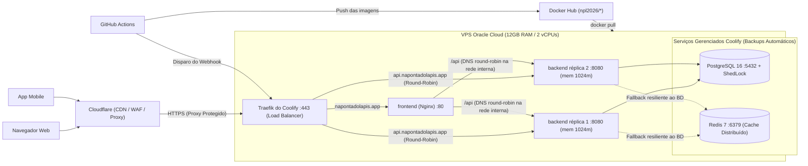
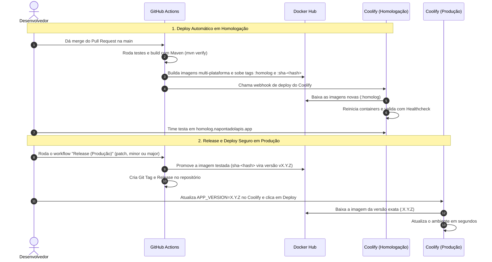

# Como funciona o Deploy e o CI/CD do Na Ponta do Lápis 

Documentação prática de como a nossa infraestrutura e a esteira de CI/CD foram organizadas para colocar o projeto no ar, dividindo os ambientes em **Homologação** (pra testar tudo antes) e **Produção** (ambiente real do usuário).

---

## 1. Como a nossa infraestrutura tá montada

A aplicação roda em uma **VPS na Oracle Cloud** (12 GB RAM / 2 vCPUs) utilizando o **Coolify** como orquestrador, com o **Cloudflare** na borda (CDN, WAF, proxy reverso e proteção de IP) e o **Traefik** atuando como proxy reverso, Load Balancer e gerenciador de certificados SSL/HTTPS automáticos.

O modelo oficial de deploy utiliza **[docker-compose.deploy.yml](docker-compose.deploy.yml)** com os bancos desacoplados: **PostgreSQL 16** e **Redis 7** rodam como serviços gerenciados nativamente pelo Coolify (garantindo backups automáticos agendados pelo painel), enquanto cada ambiente (Homologação e Produção) sobe seu stack com **múltiplas réplicas do Backend** (`deploy.replicas`) e **Frontend (Nginx)**.

### Recursos preparados no backend para múltiplas réplicas:
- **Graceful Shutdown + Virtual Threads (Java 21):** `server.shutdown=graceful` (até 30s para concluir requisições em andamento durante deploys/rolling updates) e `spring.threads.virtual.enabled=true` para lidar com alto I/O sem inflar memória.
- **Limite explícito de memória (`mem_limit: 1024m`):** Como o `Dockerfile` usa `-XX:MaxRAMPercentage=75`, cada réplica é limitada a 1024 MB (~768 MB de heap máximo), evitando consumo excessivo dos 12 GB da VPS.
- **ShedLock (Lock distribuído em PostgreSQL):** Os agendamentos `@Scheduled` (sincronização automática do Open Finance) usam `@SchedulerLock` na tabela `shedlock` para garantir que apenas **uma réplica** execute o job por janela.
- **Cache Distribuído com Redis + Fallback Seguro:** Cache compartilhado entre réplicas para autenticação (`usuario_auth`, TTL 5 min via DTO serializável sem proxies JPA) e categorias (`categorias`, TTL 60 min). Se o Redis ficar temporariamente indisponível, o `CacheErrorHandler` registra aviso e recorre automaticamente ao PostgreSQL, e `REDIS_HEALTH_ENABLED=false` impede que uma oscilação do cache tire as réplicas de rotação no healthcheck.

### Cuidados de segurança que tomamos:
- **Proteção de Borda com Cloudflare:** O IP público real da VPS Oracle fica 100% oculto atrás da rede Anycast da Cloudflare, com proteção contra DDoS, WAF e aceleração de cache CDN para o frontend.
- **Rastreabilidade e IP Real:** O Traefik do Coolify está configurado com `trustedIPs` oficiais da Cloudflare, garantindo que o cabeçalho `CF-Connecting-IP` repasse o IP verdadeiro de cada visitante para os logs e para o Spring Boot.
- **Portas fechadas no host:** A gente não usa `ports:` aberta no servidor. Apenas o Traefik escuta as portas públicas `80` e `443`.
- **Banco e Redis blindados:** PostgreSQL e Redis operam apenas na rede interna Docker/Coolify (`expose`), nunca expostos para a internet.
- **Homologação e Produção separados:** Cada ambiente tem sua própria rede/bancos dedicados. O que testamos ou quebramos em homologação não afeta a produção.

---

## 2. A sacada do acesso híbrido: Web vs Mobile

Ao planejar a API, resolvemos um problema clássico de arquitetura: **como servir o frontend web e o aplicativo mobile ao mesmo tempo sem dor de cabeça com CORS e sem precisar compilar o Angular duas vezes?**

Adotamos uma abordagem híbrida:

| Quem tá chamando? | Por onde entra? | Como funciona na prática? | Vantagem |
|---|---|---|---|
| **Frontend Web** | `napontadolapis.app/api` | O Angular faz chamadas relativas (`/api/...`). O Nginx do próprio container recebe e repassa internamente pro Spring Boot. | **Zero erro de CORS** e sem requisição extra de preflight (`OPTIONS`). Além disso, a **mesma imagem Docker** de homologação serve pra produção sem precisar de rebuild. |
| **App Mobile / Terceiros** | `api.napontadolapis.app/api/v1` | O app mobile chama direto o subdomínio da API pelo Traefik. | Apps nativos (Kotlin/Flutter/React Native) não sofrem com regras de CORS de navegador e já consomem uma URL pública direta. |

> Ambas as rotas chegam no **mesmo container backend**, sem duplicar código nem subir instâncias extras à toa.

---

## 3. O fluxo de CI/CD no dia a dia

Toda a automação foi desenhada no **GitHub Actions** pra evitar trabalho manual e garantir que nada quebrado chegue em produção:

---

## 4. Guia rápido pra equipe

### Subindo uma feature nova (Homologação)
1. Trabalhe na sua branch normalmente e abra um Pull Request para a `main`.
2. O CI valida o código e executa os testes automatizados do backend e frontend.
3. Fez o merge na `main`? **O deploy em homologação é 100% automático!**
   - O GitHub Actions builda as imagens, sobe pro Docker Hub e avisa o Coolify.
   - Poucos minutos depois, a versão já tá disponível pra testar em:  
     **Web:** `https://homolog.napontadolapis.app`  
     **API:** `https://api-homolog.napontadolapis.app/api/v1`

---

### Lançando uma versão nova (Produção)
Quando a versão em homologação estiver testada e aprovada:
1. Vá na aba **Actions** do GitHub.
2. Selecione o workflow **Release (Produção)** e clique em **Run workflow**.
3. Escolha o tipo de versão:
   - `patch`: Correções de bugs (ex: `1.0.0` → `1.0.1`).
   - `minor`: Novas funcionalidades sem quebrar o que já existe (ex: `1.0.0` → `1.1.0`).
   - `major`: Mudanças estruturais grandes (ex: `1.0.0` → `2.0.0`).
4. O workflow vai calcular a versão automaticamente e promover a imagem do Docker Hub **sem recompilar nada do zero** (garantindo que o que vai pra produção é exatamente o que testamos em homologação).
5. No painel do **Coolify**:
   - Vá no recurso de **Produção** → aba **Environment Variables**.
   - Atualize `APP_VERSION` com a versão gerada (ex: `1.0.1`).
   - Clique no botão **Deploy**. Pronto!

---

### Deu ruim em produção? Como fazer Rollback:
Como todas as versões no Docker Hub são salvas com tags fixas (`1.0.0`, `1.0.1`...):
1. Abra o recurso de Produção no Coolify.
2. Mude `APP_VERSION` de volta para a versão estável anterior (ex: `1.0.0`).
3. Clique em **Deploy**.
4. Em menos de 1 minuto o container antigo volta a rodar, sem precisar de commit de emergência na correria.

---

## 5. Como o Compose de Deploy está estruturado

O arquivo oficial **[docker-compose.deploy.yml](docker-compose.deploy.yml)** é usado tanto em Homologação quanto em Produção no Coolify:

- **PostgreSQL 16 e Redis 7 (gerenciados no Coolify):** Criados separadamente como bancos nativos do Coolify para permitir backups automáticos, retenção configurável e métricas independentes do ciclo de deploy da aplicação.
- **`backend` (Spring Boot):** Sobe com `deploy.replicas: ${BACKEND_REPLICAS:-2}` e `mem_limit: 1024m`, conectado à rede interna `default` (junto do frontend) e à rede externa `coolify` (para Traefik, PostgreSQL e Redis). O Traefik só envia tráfego quando `/api/actuator/health` retornar `UP`.
- **`frontend` (Angular + Nginx):** Puxa `npl2026/frontend:${APP_VERSION}` (`mem_limit: 128m`) e encaminha chamadas `/api` para `http://backend:8080` na rede interna isolada de cada ambiente, com balanceamento automático via DNS Docker entre as réplicas daquele ambiente.

### Variáveis de ambiente no Coolify (homologação x produção)

O Coolify só entrega ao container as variáveis que aparecem no bloco `environment:` do compose, então configure esta matriz no painel de cada recurso:

| Variável | Homologação | Produção | Para que serve |
|---|---|---|---|
| `APP_VERSION` | `homolog` | `1.0.1`, `1.0.2`... | Tag da imagem no Docker Hub |
| `BACKEND_REPLICAS` | `1` (ou `2`) | `2` | Número de réplicas do backend no stack |
| `SPRING_PROFILES_ACTIVE` | `prod` | `prod` | Profile do backend deployado (o nome `prod` vale para os dois ambientes) |
| `SPRING_JPA_HIBERNATE_DDLAUTO` | `update` | `update` (ou `validate` com Flyway) | Homolog atualiza schema; em prod alterne para `validate` quando ativar Flyway |
| `FLYWAY_ENABLED` | `false` | `false` (`true` após transição) | Habilita migrations versionadas (`db/migration`) com `baseline-on-migrate=true` |
| `APP_SEED_ENABLED` | `true` | `false` | Popula dados de demonstração no primeiro start (banco vazio) |
| `APP_WEB_URL` | `https://homolog.napontadolapis.app` | `https://napontadolapis.app` | URL usada nos redirects e na página de erro da API |
| `SWAGGER_ENABLED` | `true` | `false` | Expõe (ou não) o Swagger UI |
| `CORS_ALLOWED_ORIGINS` | `https://homolog.napontadolapis.app` | `https://napontadolapis.app,https://www.napontadolapis.app` | Origens liberadas no navegador |
| `DB_URL` / `DB_USER` / `DB_PASSWORD` | credenciais Postgres | credenciais Postgres | Conexão JDBC com o PostgreSQL gerenciado no Coolify |
| `CACHE_TYPE` | `redis` | `redis` | `redis` (cache compartilhado entre réplicas) ou `simple` (memória local) |
| `REDIS_HOST` / `REDIS_PORT` / `REDIS_PASSWORD` | dados do Redis | dados do Redis | Conexão com o Redis 7 gerenciado no Coolify |
| `REDIS_HEALTH_ENABLED` | `false` | `false` | Mantém `/api/actuator/health` independente de oscilações no Redis |
| `JWT_SECRET` | segredo próprio | segredo próprio | Assinatura dos tokens |
| `FATURA_COOKIE_SECRET` | segredo próprio | segredo próprio | Criptografia (AES-GCM) da chave de IA no cookie de sessão (se ausente, usa o `JWT_SECRET`) |
| `FATURA_OCR_ENABLED` | `true` | `true` | Ativa/desativa OCR local de PDFs escaneados via Tesseract |
| `FATURA_IA_GEMINI_MODEL` | `gemini-2.5-flash` | `gemini-2.5-flash` | Modelo padrão do Google Gemini |
| `FATURA_IA_CLAUDE_MODEL` | `claude-sonnet-4-5` | `claude-sonnet-4-5` | Modelo padrão da Anthropic Claude |
| `FATURA_IA_OPENAI_MODEL` | `gpt-4.1-mini` | `gpt-4.1-mini` | Modelo padrão da OpenAI |
| `FATURA_IA_DEEPSEEK_MODEL` | `deepseek-chat` | `deepseek-chat` | Modelo padrão da DeepSeek |
| `FATURA_IA_GROQ_MODEL` | `llama-3.3-70b-versatile` | `llama-3.3-70b-versatile` | Modelo padrão da Groq |
| `CLOUDINARY_CLOUD_NAME` / `CLOUDINARY_API_KEY` / `CLOUDINARY_API_SECRET` | credenciais | credenciais | Upload de imagens/comprovantes |

> **Importante:** o [docker-compose.deploy.yml](docker-compose.deploy.yml) já define defaults seguros (`SPRING_PROFILES_ACTIVE:-prod`, `APP_SEED_ENABLED:-false`, `FLYWAY_ENABLED:-false`, `CACHE_TYPE:-redis`, `REDIS_HEALTH_ENABLED:-false`).
>
> **Migrations com Flyway e ShedLock:** O projeto já inclui `org.flywaydb:flyway-core` e a migration inicial `V1__create_shedlock.sql`, mantendo `FLYWAY_ENABLED=false` por padrão para não quebrar bancos já criados com `ddl-auto=update`. Quando for adotar migrations em produção, habilite `FLYWAY_ENABLED=true` (`baseline-on-migrate=true` já está ativo) e mude `SPRING_JPA_HIBERNATE_DDLAUTO=validate`. A tabela `shedlock` também é garantida na inicialização do backend via `SchedulingLockConfig`.

> O OCR local usa o binário `tesseract` (idioma `por`), que já é instalado na imagem do backend. Não há variável de ambiente obrigatória; para desligar o OCR use `FATURA_OCR_ENABLED=false`.
