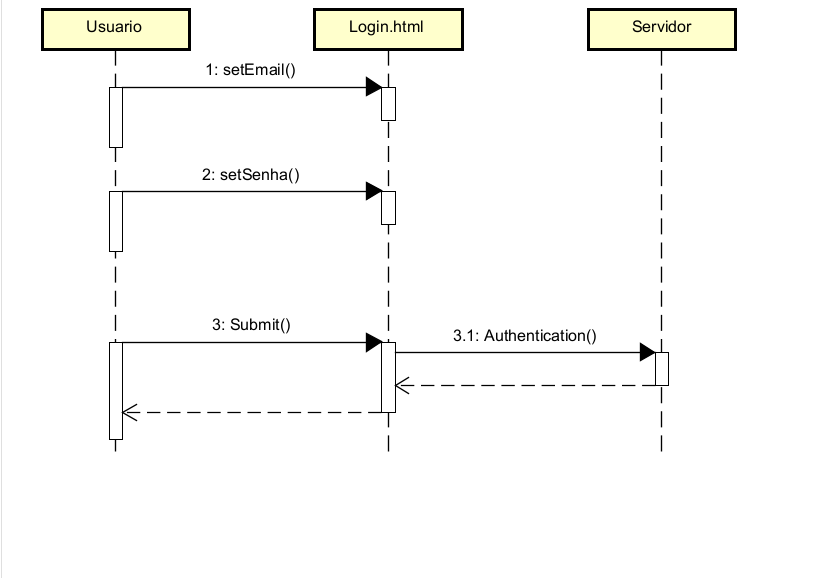

# CDU 01. Login

- **Ator principal**: Visitante
- **Atores secundários**: Google Identity Services (opcional, para login social).
- **Resumo**: O caso de uso Login permite que um usuário já cadastrado acesse o sistema informando seu **e-mail ou nome de usuário** e senha, ou utilizando sua conta Google (ver [CDU-34](../cdu-34/detalhamento-34.md)). O sistema verifica se as credenciais correspondem a um usuário existente, autentica o usuário com token JWT e redireciona para o Dashboard. A tela conta ainda com o mascote interativo (Lápis NPL), que acompanha o preenchimento e reage ao sucesso ou erro da autenticação.
- **Pré-condição**: Não deve estar autenticado.
- **Pós-Condição**: Usuário é autenticado no sistema com token JWT válido e redirecionado ao Dashboard (`/app/dashboard`).

## Fluxo Principal

| Ações do Ator | Ações do Sistema |
| :-----------------: | :-----------------: |
| 1. Acessa a tela de [Login](https://www.figma.com/proto/hbbNIiCbHjSmDtWXFRDvgs/Na-Ponta-do-Lapis?node-id=1545-21654&t=gZFvJtLbjEaf6iYW-0&scaling=min-zoom&content-scaling=fixed&page-id=625%3A100&starting-point-node-id=1545%3A21654). | |
| 2. Informa o **e-mail ou nome de usuário** e a **senha** nos campos do formulário e clica em **"Entrar"**. | |
| | 3. Sistema recebe as credenciais (`POST /api/v1/auth/login`). |
| | 4. Localiza o usuário pelo e-mail ou nome de usuário informado. |
| | 5. Valida a senha informada comparando com o hash BCrypt armazenado. |
| | 6. Gera um token JWT assinado e armazena na sessão local (`StorageService`). |
| | 7. Redireciona para o [Dashboard](https://www.figma.com/proto/hbbNIiCbHjSmDtWXFRDvgs/Na-Ponta-do-Lapis?node-id=1545-21660&t=gZFvJtLbjEaf6iYW-0&scaling=min-zoom&content-scaling=fixed&page-id=625%3A100&starting-point-node-id=1545%3A21654) (`/app/dashboard`). |

## Fluxo Alternativo I - Credenciais inválidas ou inexistentes

| Ações do ator | Ações do sistema |
| :-----------------: |:-----------------: |
| 2.1 - Informa e-mail/nome de usuário ou senha incorretos. | |
| | 2.2 - Exibe notificação de erro (*"E-mail, nome de usuário ou senha inválido."*) e aciona o estado de erro do mascote. |

## Fluxo Alternativo II - Continuar com Google

| Ações do ator | Ações do sistema |
| :-----------------: |:-----------------: |
| 1.1 - Clica no botão oficial **"Continuar com o Google"** no topo do formulário. | |
| | 1.2 - Executa o fluxo de autenticação social com Google ([CDU-34](../cdu-34/detalhamento-34.md)). |

## Diagrama de Interação (Sequência ou Comunicação)

