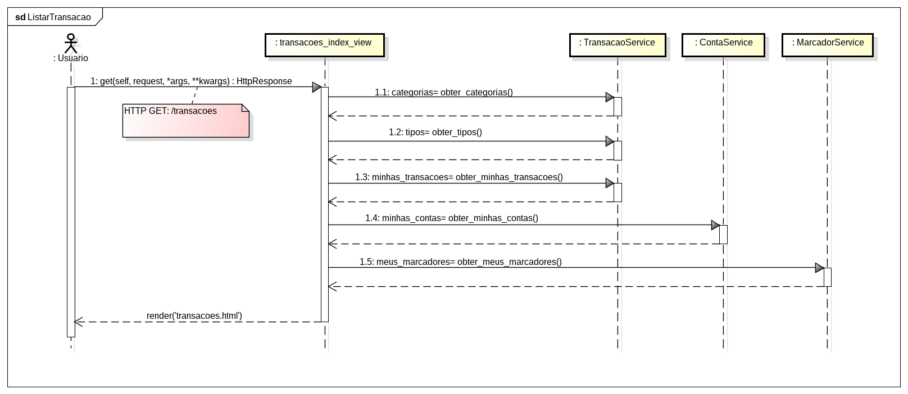
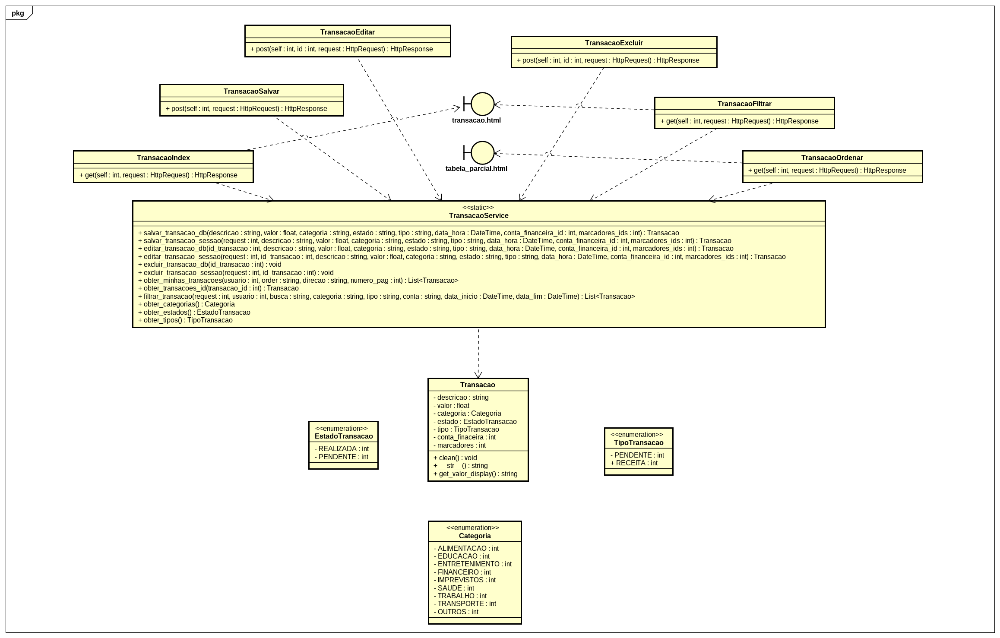

# CDU 18. Manter Transação

- **Ator principal**: Cliente.
- **Atores secundários**: Sistema de Banco de Dados.
- **Resumo**: Na página de **Transações** (`/app/transacoes`), o cliente gerencia suas movimentações de **Receita** e **Despesa** (à vista ou **parceladas**). O formulário permite informar tipo, descrição, valor, conta financeira, categoria, data, situação (`REALIZADA` ou `PENDENTE`), marcador opcional e configuração de **compra parcelada** (parcela atual, total de parcelas e geração opcional de parcelas anteriores). O módulo também permite **confirmar pagamento** de transações pendentes, gerenciar grupos de parcelamento e **excluir movimentações individualmente ou em lote**.
- **Pré-condição**: O Cliente deve estar autenticado no sistema.
- **Pós-condição**: O sistema persiste as alterações no banco de dados e atualiza automaticamente o saldo da conta financeira correspondente.

## Fluxo Principal (Criar Transação Manual)

| Ações do ator | Ações do sistema |
| :-: | :-: |
| 1 - Cliente clica em **"Nova Transação"** e escolhe **"Lançamento Manual"**. | |
| | 2 - Sistema exibe o modal com seletor de tipo (**Despesa** / **Receita**) e campos obrigatórios (*descrição*, *valor*, *conta*, *categoria*, *data*, *situação*) mais marcador e opção **Compra parcelada**. |
| 3 - Cliente preenche os campos e clica em **"Criar Transação"**. | |
| | 4 - Sistema valida os dados (`POST /api/v1/transacoes`), cria a transação (e as parcelas vinculadas ao `grupoParcelamento`, quando parcelada), atualiza o saldo da conta (se `REALIZADA`) e exibe confirmação. |

## Fluxo Alternativo I - Editar Transação

| Ações do ator | Ações do sistema |
| :-: | :-: |
| 1.1 - Cliente clica no ícone de edição de uma transação na tabela. | |
| | 2.1 - Sistema exibe o formulário pré-preenchido com os dados atuais. |
| 3.1 - Cliente altera os dados desejados e clica em **"Salvar Alterações"** (`PUT /api/v1/transacoes/{id}`). | |
| | 4.1 - Sistema valida, recalcula o impacto no saldo da conta e persiste as alterações. |

## Fluxo Alternativo II - Confirmar Pagamento de Transação Pendente

| Ações do ator | Ações do sistema |
| :-: | :-: |
| 1.2 - Cliente clica no botão de confirmar pagamento em uma transação com estado `PENDENTE`. | |
| | 2.2 - Sistema exibe modal de confirmação com resumo da movimentação. |
| 3.2 - Cliente confirma a operação (`PATCH /api/v1/transacoes/{id}/confirmar-pagamento`). | |
| | 4.2 - Sistema altera o estado para `REALIZADA` e aplica o valor no saldo da conta financeira. |

## Fluxo Alternativo III - Gerenciar Grupo de Parcelamento

| Ações do ator | Ações do sistema |
| :-: | :-: |
| 1.3 - Cliente clica no badge de parcela (`ex: 2/10`) de uma compra parcelada. | |
| | 2.3 - Sistema consulta `GET /api/v1/transacoes/parcelamento/{grupoId}` e exibe todas as parcelas do grupo, permitindo gerar parcelas futuras (`/futuras`), anteriores (`/anteriores`) ou excluir o parcelamento (todas ou apenas futuras). |

## Fluxo Alternativo IV - Excluir Transação (Individual ou em Lote)

| Ações do ator | Ações do sistema |
| :-: | :-: |
| 1.4 - Cliente clica no ícone de lixeira de uma transação ou seleciona múltiplas transações na tabela e clica em excluir selecionadas. | |
| | 2.4 - Sistema exibe janela de confirmação informando o estorno no saldo da conta. |
| 3.4 - Cliente confirma a exclusão (`DELETE /api/v1/transacoes/{id}` ou `POST /api/v1/transacoes/excluir-lote`). | |
| | 4.4 - Sistema remove os registros, estorna o saldo das contas afetadas e atualiza a listagem. |

## Diagrama de Interação (Sequência ou Comunicação)

## Diagrama de Classes de Projeto

