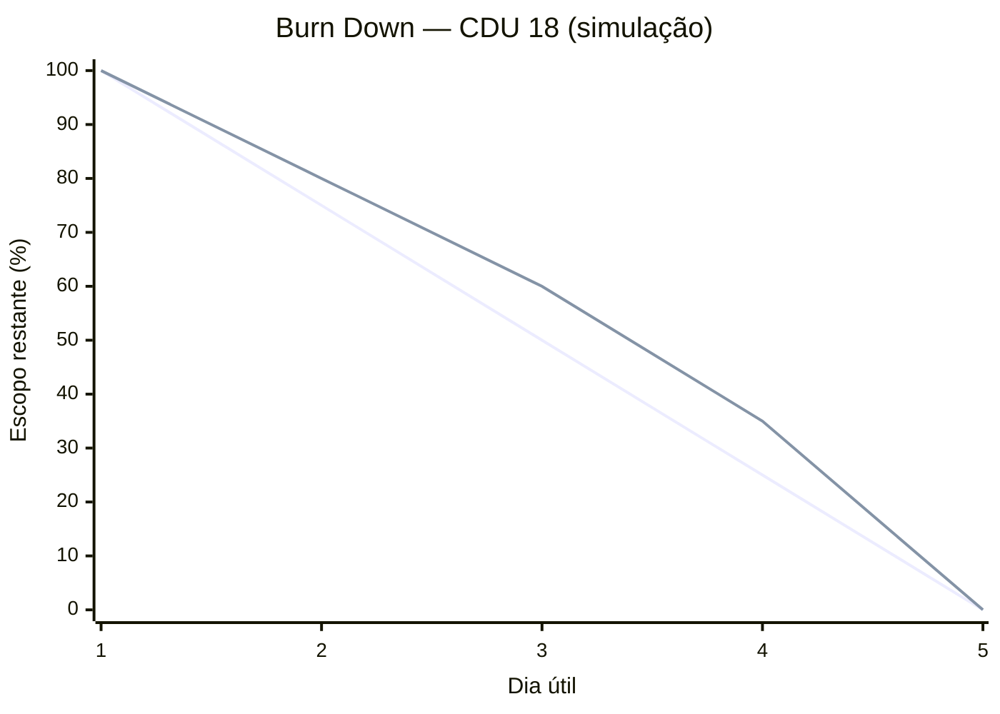
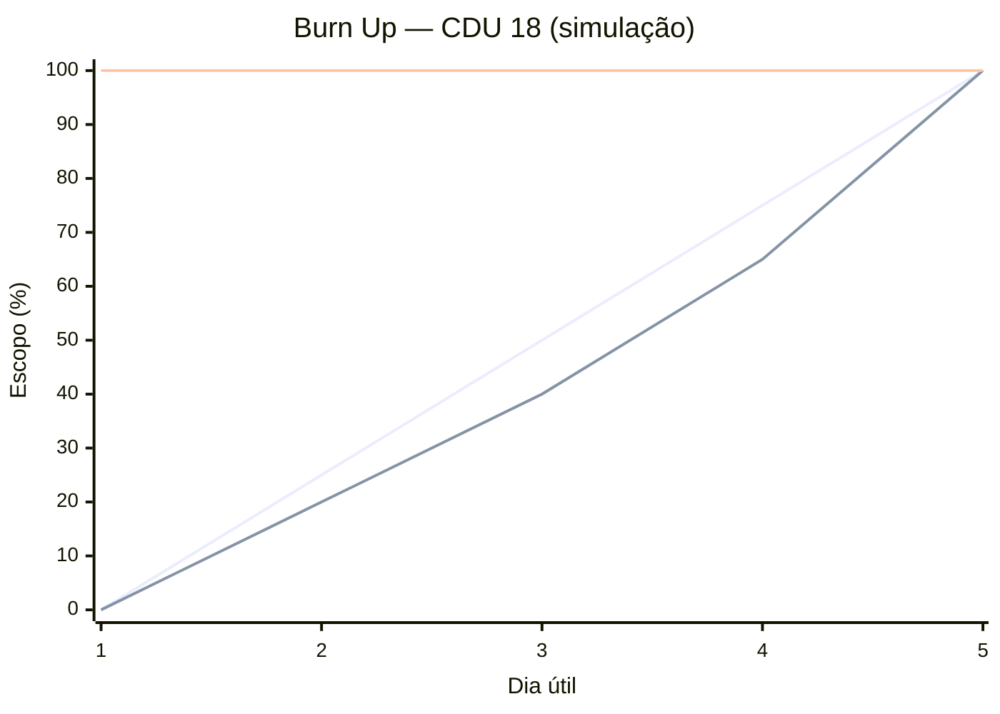

# Planejamento de Entregas Parciais

| Data | Entrega | Complexidade Estimada |
| :---: | :--- | :--- |
| **28/04** | [CDU 19 - Manter conta](../cdu/cdu-19/detalhamento-19.md) | 🟢 Baixa |
| **05/05** | [CDU 18 - Manter transação](../cdu/cdu-18/detalhamento-18.md) | 🔴 Alta |
| **12/05** | [CDU 22 - Manter família](../cdu/cdu-22/detalhamento-22.md) | 🔴 Alta |
| **19/05** | [CDU 06 - Relatório pessoal](../cdu/cdu-06/detalhamento-06.md), [CDU 24 - Relatório da família](../cdu/cdu-24/detalhamento-24.md) | 🟡 Média |
| **26/05** | [CDU 01 - Login](../cdu/cdu-01/detalhamento-01.md), [CDU 02 - Logout](../cdu/cdu-02/detalhamento-02.md), [CDU 03 - Cadastro](../cdu/cdu-03/detalhamento-3.md) | 🟡 Média |
| **02/06** | [CDU 17 - Manter meta](../cdu/cdu-17/detalhamento-17.md), [CDU 16 - Manter marcador](../cdu/cdu-16/detalhamento-16.md) |🟡 Média |
| **09/06** | [CDU 13 - Manter post](../cdu/cdu-13/detalhamento-13.md), [CDU 07 - Visualizar post](../cdu/cdu-07/detalhamento-07.md) | 🟡 Média |
| **16/06** | [CDU 15 - Admin do site](../cdu/cdu-15/detalhamento-15.md), [CDU 23 - Tornar admin da família](../cdu/cdu-23/detalhamento-23.md) | 🟢 Baixa  |
| **23/06** | [CDU 04 - Recuperar senha](../cdu/cdu-04/detalhamento-04.md), [CDU 20 - Atualizar Perfil](../cdu/cdu-20/detalhamento-20.md) | 🟢 Baixa  |
| **30/06** | [CDU 12 - Alterar Tema](../cdu/cdu-12/detalhamento-12.md), [CDU 05 - Visualizar cotação](../cdu/cdu-05/detalhamento-05.md) | 🟢 Baixa |
| **07/07** | Apresentação Wtads | - |
| **14/07** | Entrega Final | - |

## Gráficos de Burn Down e Burn Up — Sprint de Exemplo

O cronograma prevê a entrega do **CDU 18 — Manter transação** em 05/05, mas não informa o ano, a duração da sprint ou o progresso diário. Por isso, os gráficos abaixo são uma **simulação demonstrativa**, não um registro histórico. O escopo foi normalizado para 100%; os dias representam cinco dias úteis da sprint.

### Burn Down

Mostra o percentual de trabalho restante ao longo da sprint. A linha ideal distribui o trabalho igualmente; a linha simulada representa um exemplo de execução.

Legenda, na ordem das linhas: ideal; simulado.

### Burn Up

Mostra o percentual concluído. A linha de escopo total permanece em 100%; as demais linhas mostram o avanço ideal e o avanço simulado.

Legenda, na ordem das linhas: ideal; simulado; escopo total.

Para representar o acompanhamento real, substitua os valores simulados pelos registros diários da sprint e ajuste a linha de escopo caso o backlog mude.
