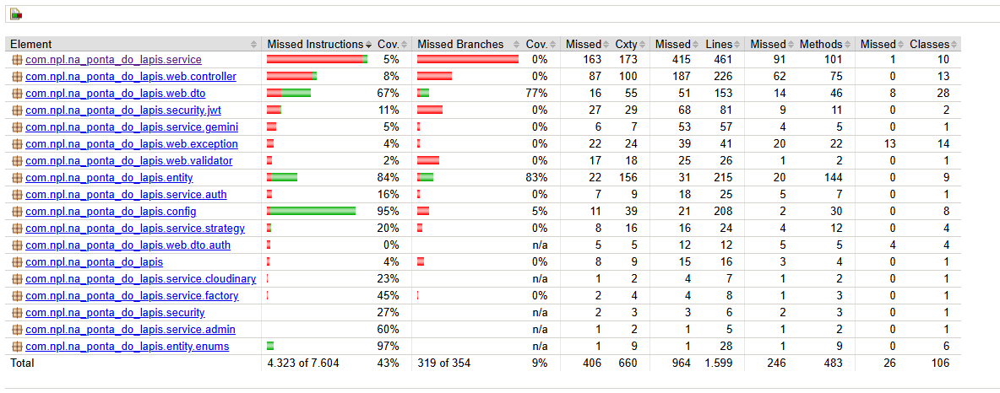
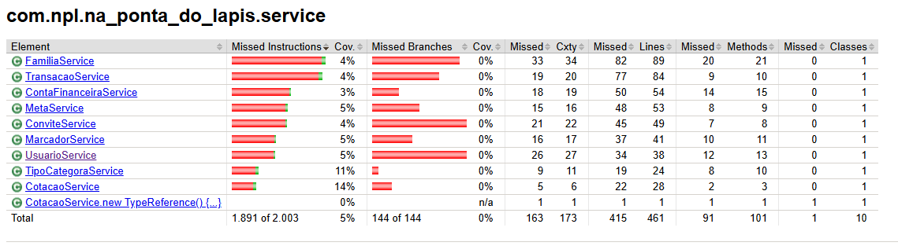
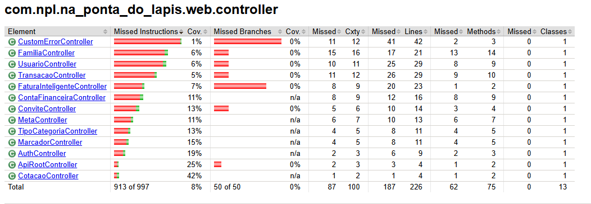

# Relatório de Cobertura do Projeto - Na Ponta do Lápis

Este documento apresenta a análise de cobertura do sistema **Na Ponta do Lápis** (Spring Boot), dividida entre a **Cobertura de Requisitos** (baseada nos Casos de Uso - CDUs) e a **Cobertura de Código** (medida via JaCoCo).

---

## 1. Cobertura de Código (JaCoCo - Spring Boot)

Análise gerada automaticamente através do **JaCoCo Maven Plugin** no ambiente do projeto.

### Resumo Executivo das Métricas Gerais (Código)

* **Instruções (Instructions):** **43%** de cobertura (4.323 de 7.604 instruções cobertas).
* **Ramos/Desvios (Branches):** **9%** de cobertura (35 de 354 desvios testados).
* **Linhas de Código (Lines):** **39,7%** de cobertura (964 de 1.599 linhas cobertas).
* **Métodos:** **49,1%** de cobertura (237 de 483 métodos testados).
* **Classes:** **75,5%** de cobertura (80 de 106 classes com alguma execução).

### Análise Detalhada por Pacote Principal

| Pacote Java | Cobertura de Instruções (%) | Cobertura de Branches (%) | Linhas Não Cobertas | Status / Diagnóstico |
| :---------: | :-------------------------: | :-----------------------: | :-----------------: | :------------------: |
| `com.npl.na_ponta_do_lapis.service` | **5%** | **0%** | 415 / 461 | 🔴 **Crítico** (Regras de negócio sem testes) |
| `com.npl.na_ponta_do_lapis.web.controller` | **8%** | **0%** | 187 / 226 | 🔴 **Crítico** (Endpoints REST não integrados) |
| `com.npl.na_ponta_do_lapis.web.dto` | **67%** | **77%** | 51 / 153 | 🟡 **Médio** (Estruturas de transporte) |
| `com.npl.na_ponta_do_lapis.entity` | **84%** | **83%** | 31 / 215 | 🟢 **Bom** (Entidades de domínio) |
| `com.npl.na_ponta_do_lapis.config` | **95%** | **5%** | 21 / 208 | 🟢 **Bom** (Configurações Spring) |
| `com.npl.na_ponta_do_lapis.entity.enums` | **97%** | **N/A** | 1 / 28 | 🟢 **Bom** (Enumerações) |

---

### Imagens do Relatório HTML Gerado pelo JaCoCo

* **Cobertura Geral do Projeto**



* **Cobertura dos Services**



* **Cobertura dos Controllers**



## 2. Comandos para Reprodução Local

Para gerar este relatório novamente na sua máquina local, execute:

```bash
# Limpa compilações anteriores, roda os testes e gera o relatório JaCoCo
mvn clean test jacoco:report
```

O relatório HTML detalhado estará disponível na pasta:
`target/site/jacoco/index.html`

---

## 3. Links e Referências no GitHub

* **Relatório JaCoCo (HTML):** [Visualizar target/site/jacoco](https://github.com/seu-usuario/na-ponta-do-lapis/tree/main/target/site/jacoco)

---

## 1. Cobertura de Requisitos (CDUs e RFs)

## Premissas de cálculo

* **Requisito de Teste (RfT):** cada CDU documentado (13) e, em segundo nível, cada RF do documento de visão (35).

* **Teste (T):** T é contado por requisito: um requisito conta como coberto quando tem pelo menos 1 caso de teste na etapa medida.

### Resumo Executivo das Métricas Gerais (Requisitos)

* **Casos de teste documentados (Tp):** 13 CDUs

* **Planejados :** **34,3%** de cobertura plena (12 de 35 RFs)
* **Implementados:** **0%**
* **Executados:** **0%**
* **Bem-sucedidos:** **0%**

### Medições da Aula

| Medição | Fórmula | Adaptação neste projeto | Resultado |
| :-----: | :-----: | :---------------------: | :-------: |
| **Planejados** | Tp / RfT | RFs com cobertura plena / total de RFs | **34,3%** (12/35) |
| **Implementados** | Ti / RfT | CDUs com script de teste / total de CDUs | **0%** (0/35) |
| **Executados** | Tx / RfT | CDUs com ≥ 1 caso executado / total de CDUs | **0%** (0/35) |
| **Bem-sucedidos** | Ts / RfT | CDUs com casos executados sem falha / total de CDUs | **0%** (0/35) |

---

## 2. Análise Detalhada por CDU

| CDU | Nome | Arquivo | RFs relacionados | Tp (casos) | Ti | Tx | Ts | Qualidade do plano |
| :-: | :--- | :------ | :--------------: | :--------: | :-: | :-: | :-: | :----------------: |
| 01 | Login | `teste-wagner.md` | RF02 | 6 | 0 | 0 | 0 | 🟢 **Bom** |
| 02 | Logout | `testes-pedro.md` | RF03 | 2 | 0 | 0 | 0 | 🟡 **Médio** |
| 03 | Cadastro de Usuário | `teste-wagner.md` | RF01 | 16 | 0 | 0 | 0 | 🟢 **Bom** |
| 12 | Alterar Tema | `testes-pedro.md` | sem RF na especificação | 3 | 0 | 0 | 0 | 🟡 **Médio** |
| 16 | Manter Marcador (Temporário) | `teste_lucas.md` | RF29, RF32, RF33 | 5 | 0 | 0 | 0 | 🟡 **Médio** |
| 17 | Manter Meta | `cdu_17-Vinicius.md` | RF24 | 8 | 0 | 0 | 0 | 🟡 **Médio** |
| 18 | Manter Transação | `cdu18-Erick.md` | RF05, RF07, RF08 | 15 | 0 | 0 | 0 | 🟡 **Médio** |
| 19 | Manter Conta | `casos-testes-bruno.md` | RF10, RF12, RF13 | 15 | 0 | 0 | 0 | 🟡 **Médio** |
| 20 | Atualizar Perfil | `teste_cdu20_Eduardo.md` | RF04 | 15 | 0 | 0 | 0 | 🟡 **Médio** |
| 21 | Remover Membro da Família | `cdu_21-Vinicius.md` | RF22 | 4 | 0 | 0 | 0 | 🟡 **Médio** |
| 22 | Convidar Membro à Família | `teste_cdu22_Eduardo.md` | RF20, RF16 (indireto) | 9 | 0 | 0 | 0 | 🟢 **Bom** |
| 23 | Tornar Administrador da Família | `cdu23-Erick.md` | RF23 | 4 | 0 | 0 | 0 | 🟢 **Bom** |
| 26 | Adicionar Transação pela Fatura | `casos-testes-bruno.md` | RF05, RF15 | 8 | 0 | 0 | 0 | 🟡 **Médio** |
| | **Total** | | | **110** | **0** | **0** | **0** | |

---

## 3. Cobertura por Requisito Funcional (RF)

Legenda: ✅ **Coberto** · 🟡 **Parcial** · 🔴 **Não coberto**

| RF | Nome | Prioridade | CDU/Teste | Situação |
| -- | :--: | :--------: | :-------: | :------: |
| RF01 | Cadastro de usuário | Alta | CDU 03 | ✅ |
| RF02 | Login de usuário | Alta | CDU 01 | ✅ |
| RF03 | Logout de usuário | Alta | CDU 02 | ✅ |
| RF04 | Editar conta de usuário | Alta | CDU 20 | ✅ |
| RF05 | Cadastrar transação | Alta | CDU 18 (criação) e Fatura | ✅ |
| RF06 | Visualizar transação | Alta | CDU 18 | 🔴 |
| RF07 | Excluir transação | Alta | CDU 18 | 🟡 |
| RF08 | Editar transação | Alta | CDU 18 | 🟡 |
| RF09 | Visualização de relatórios | Alta | - | 🔴 |
| RF10 | Cadastrar conta financeira | Média | CDU 19 | ✅ |
| RF11 | Visualizar conta financeira | Média | CDU 19 | 🔴 |
| RF12 | Excluir conta financeira | Média | CDU 19 | ✅ |
| RF13 | Editar conta financeira | Média | CDU 19 | ✅ |
| RF14 | Visualizar categoria | Média | - | 🔴 |
| RF15 | Vincular categoria | Média | Fatura (categoria por nome); CDU 18 sem caso de categoria inválida | 🟡 |
| RF16 | Cadastrar família | Baixa | CDU 22 (família criada ao convidar) | 🟡 |
| RF17 | Visualizar família | Baixa | - | 🔴 |
| RF18 | Excluir família | Baixa | - | 🔴 |
| RF19 | Editar família | Baixa | - | 🔴 |
| RF20 | Convidar membro para família | Baixa | CDU 22 | ✅ |
| RF21 | Aceitar convite de uma família | Baixa | - | 🔴 |
| RF22 | Remover membro da família | Baixa | CDU 21 | ✅ |
| RF23 | Promover membro para administrador | Baixa | CDU 23 | ✅ |
| RF24 | Sistema de metas | Baixa | CDU 17 | ✅ |
| RF25 | Cadastrar posts | Baixa | - | 🔴 |
| RF26 | Visualizar posts | Baixa | - | 🔴 |
| RF27 | Excluir posts | Baixa | - | 🔴 |
| RF28 | Editar posts | Baixa | - | 🔴 |
| RF29 | Cadastrar marcador | Baixa | CDU 16 | 🟡 |
| RF30 | Vincular marcador | Baixa | - | 🔴 |
| RF31 | Visualizar marcador | Baixa | - | 🔴 |
| RF32 | Excluir marcador | Baixa | CDU 16 | 🟡 |
| RF33 | Editar marcador | Baixa | CDU 16 | 🟡 |
| RF34 | Visualizar cotação | Baixa | - | 🔴 |
| RF35 | Login com Google | Baixa | - | 🔴 |

### Resumo por Prioridade

| Prioridade | Total de RFs | ✅ Cobertos | 🟡 Parciais | 🔴 Não cobertos | Cobertura plena |
| :--------: | :----------: | :----------: | :----------: | :--------------: | :-------------: |
| Alta | 9 | 5 | 2 | 2 | **55,6%** |
| Média | 6 | 3 | 1 | 2 | **50,0%** |
| Baixa | 20 | 4 | 4 | 12 | **20,0%** |
| **Total** | **35** | **12** | **7** | **16** | **34,3%** |

---

## 4. Links e Referências

* **Casos de teste (Markdown):** [Visualizar testes](../testes.md)
* **Especificação de Requisitos Funcionais:** [Documento de visão - Requisitos Funcionais](/doc/visao/doc-visao.md#8-requisitos-funcionais)
